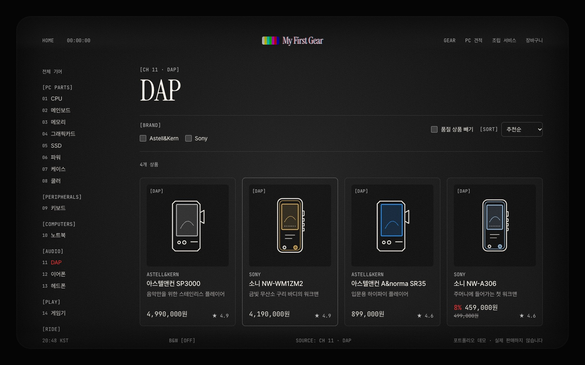
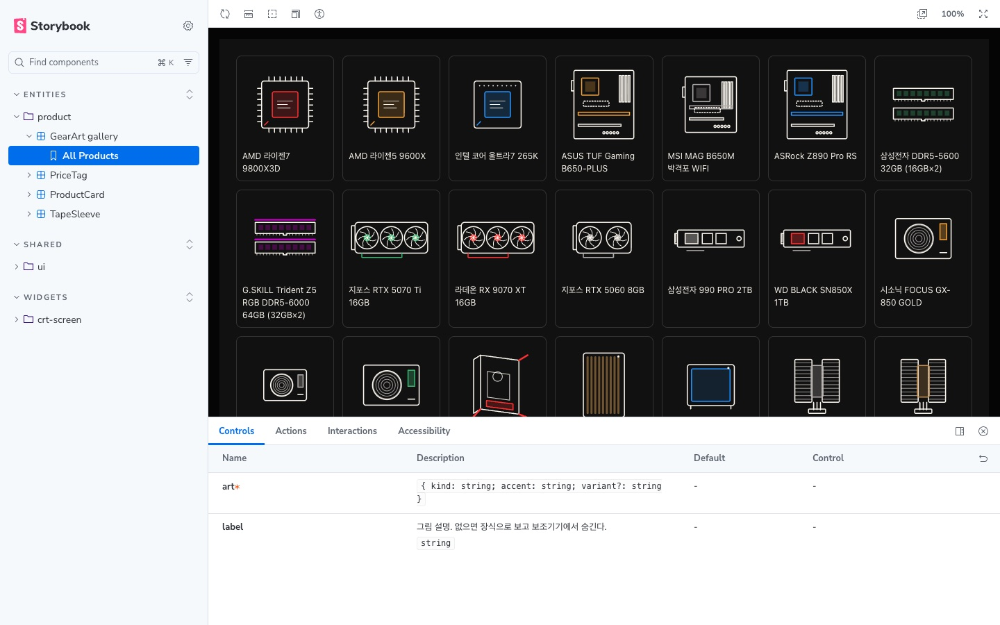

# My First Gear

[](https://github.com/ryushin01/My-First-Gear/actions/workflows/ci.yml)


컴퓨터 부품부터 오디오, 게임기, 자전거, 자동차, 시계까지 **첫 장비를 고르는 기어 숍**입니다. 부품을 골라 PC 견적을 내면 호환성을 바로 확인하고, 조립까지 맡길 수 있습니다.

> **프로젝트 상태:** 실제로 판매하지 않는 **포트폴리오 프로젝트**입니다. 상품명은 실제 모델명이지만 가격, 재고, 평점, 주문은 모두 가상 데이터이고, 결제는 모의 결제입니다. 상품 이미지는 사진 대신 로고 없이 직접 그린 SVG입니다.

## 화면

| 홈 (VHS 테이프 캐러셀) | 카테고리 목록 |
|---|---|
|  |  |

| PC 견적 | 상품 상세 |
|---|---|
|  |  |

| 마이페이지 | 상품 후기·Q&A |
|---|---|
|  |  |

| 어드민 대시보드 (Bulma) | 어드민 판매 정보 |
|---|---|
|  |  |

| 모바일 홈 | 어드민 문의 답변 | Storybook |
|---|---|---|
|  |  |  |

## 주요 기능

**쇼핑몰** (`apps/shop`, UnoCSS)

| 메뉴 | 내용 |
|---|---|
| 홈 | 브라운관 TV 프레임, ← → 키로 넘기는 VHS 테이프 캐러셀, 18개 카테고리 채널 목록 |
| 기어 | 카테고리별 목록, 브랜드·품절 필터와 정렬(주소에 유지), 상세 사양 표, 다음 상품("Next tape") |
| PC 견적·조립 | 부품 8칸 선택, 소켓·메모리·보드 크기·그래픽카드 길이·쿨러 높이·파워 용량 검사, 견적 주소 공유, 조립·OS 설치·선 정리·24시간 테스트 옵션 |
| 주문·상담 | 장바구니, 모의 결제(가격·재고는 서버에서 다시 계산), 비회원 주문 조회, 자동차·모터사이클은 구매 상담 신청 |
| 회원 | 가입·로그인(데모 `demo@myfirstgear.dev` / `demo1234`), 후기·Q&A·찜, 마이페이지(주문 내역, 저장한 견적, 찜, 1:1 문의) |

**어드민** (`apps/admin`, Bulma)

| 메뉴 | 내용 |
|---|---|
| 대시보드 | 최근 주문, 매출, 조립 중, 새 상담 건수, 재고 부족 상품 |
| 상품 판매 정보 | 가격·정가·재고·추천·노출 수정 → 쇼핑몰 캐시 즉시 갱신 |
| 주문·상담·문의 | 주문·상담 상태 변경, 1:1 문의와 상품 Q&A 답변(쇼핑몰에 바로 반영), 회원 목록 |

쇼핑몰에서 들어온 주문·상담·문의는 어드민에, 어드민에서 바꾼 가격·재고와 답변은 쇼핑몰에 바로 반영됩니다. 데모 데이터는 매일 새벽 처음 상태로 돌아갑니다. KWCAG 2.2 33개 항목은 [접근성 점검표](docs/accessibility.md)에 정리했습니다.

## 기술 스택


| 구분 | 사용 기술 |
|---|---|
| 프레임워크 | Next.js 16 (App Router, Cache Components), React 19, TypeScript |
| 구조 | pnpm 워크스페이스 + Turborepo 모노레포, Feature-Sliced Design v2.1 (steiger 검사) |
| 스타일 | 쇼핑몰 UnoCSS (`presetWind4`), 어드민 Bulma 1 |
| 데이터 | PostgreSQL (Netlify Database), Drizzle ORM, 서버 액션 |
| 품질 | ESLint, Steiger, Vitest + Testing Library(컴포넌트·스토리 axe·호환성·로컬 Postgres 통합 테스트), Playwright E2E(데스크톱·모바일, axe, 조작 크기·중복 id·더블 클릭 검사), Storybook 10 (`@storybook/nextjs-vite`) |
| 배포 | Netlify (쇼핑몰·어드민 두 사이트, 예약 함수), GitHub Actions |

## 시작하기

Node.js 24(`.nvmrc`)와 pnpm 12가 필요합니다.

```bash
nvm use
corepack enable pnpm
pnpm install
pnpm --filter shop dev:db    # 로컬 Postgres + 쇼핑몰 http://localhost:3000
pnpm --filter admin dev:db   # 같은 DB로 어드민 http://localhost:3001 (비밀번호 demo-admin)
```

| 명령 | 설명 |
|---|---|
| `pnpm build` | 두 앱 프로덕션 빌드 |
| `pnpm lint` / `typecheck` | ESLint + FSD 검사 / 타입 검사 |
| `pnpm test` | 컴포넌트·스토리·호환성·DB 통합 테스트 |
| `pnpm test:e2e` | 프로덕션 빌드를 로컬 DB로 띄워 쇼핑몰·어드민 E2E |
| `pnpm storybook` | Storybook (`http://localhost:6006`) |

## 프로젝트 구조

```
apps/
├─ shop/            쇼핑몰 (UnoCSS)
│  ├─ app/          Next 라우트 (src/_pages를 다시 내보내기만)
│  ├─ src/          FSD: _app, _pages, widgets, features, entities, shared (컴포넌트 옆에 *.stories.tsx, *.test.tsx)
│  └─ netlify/      DB 마이그레이션, 데모 초기화 예약 함수
└─ admin/           어드민 (Bulma), proxy.ts 로그인 보호
packages/
├─ catalog/         상품·카테고리·호환성 검사 (순수 TS)
├─ gear-art/        상품 SVG 그림 18종
└─ db/              Drizzle 스키마와 쿼리, 로컬 DB 실행 스크립트
```

## 문서

| 문서 | 내용 |
|---|---|
| [개발 가이드](docs/development.md) | 구조, 데이터 흐름, 디자인 기준, 접근성, 테스트 |
| [접근성 점검표](docs/accessibility.md) | KWCAG 2.2 33개 항목 대조 결과, Cache Components 주의점 |
| [배포](docs/deploy.md) | Netlify 두 사이트 설정, 환경 변수, 마이그레이션, CI |
| [버전 기록](CHANGELOG.md) | 버전별 변경 내용 |
