# My First Gear

[](https://github.com/ryushin01/My-First-Gear/actions/workflows/ci.yml)


컴퓨터 부품과 데스크 셋업(의자·책상·모니터암·조명)부터 오디오, 게임기, 자전거, 자동차, 시계, 캠핑까지 **첫 장비를 고르는 기어 숍**입니다. 부품을 골라 PC 견적을 내면 호환성을 바로 확인하고, 조립까지 맡길 수 있습니다.

**[쇼핑몰 바로 보기](https://my-first-gear-ryushin01.vercel.app/)** · **[어드민](https://my-first-gear-admin-ryushin01.vercel.app/)** (비밀번호 `demo-admin`) · 데모 회원 `demo@myfirstgear.dev` / `demo1234`

> **프로젝트 상태:** 실제로 판매하지 않는 **포트폴리오 프로젝트**입니다. 상품명은 실제 모델명이지만 가격, 재고, 평점, 주문은 모두 가상 데이터이고, 결제는 모의 결제입니다. 상품 이미지는 사진 대신 실제 제품을 보고 로고 없이 직접 그린 SVG입니다.

## 화면

| 홈 (VHS 테이프 캐러셀) | 게이밍 모니터 존 |
|---|---|
| 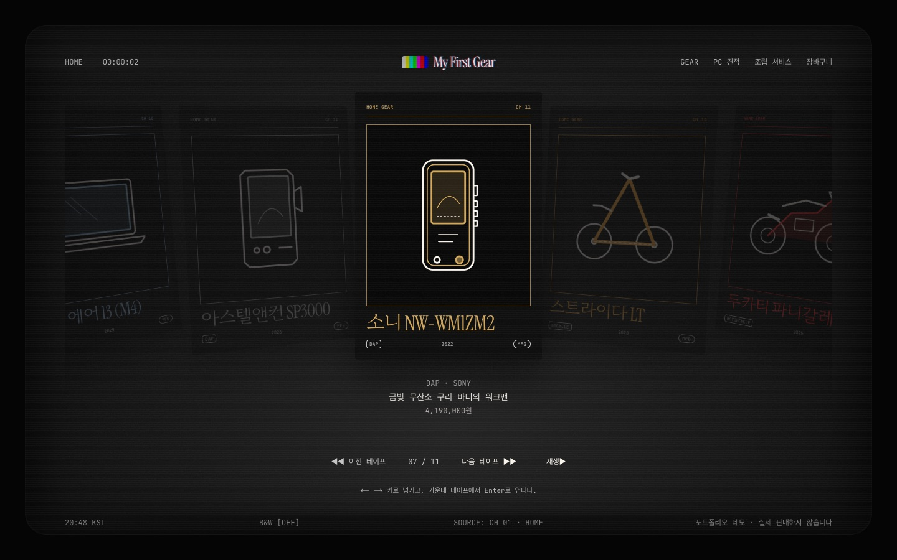 | 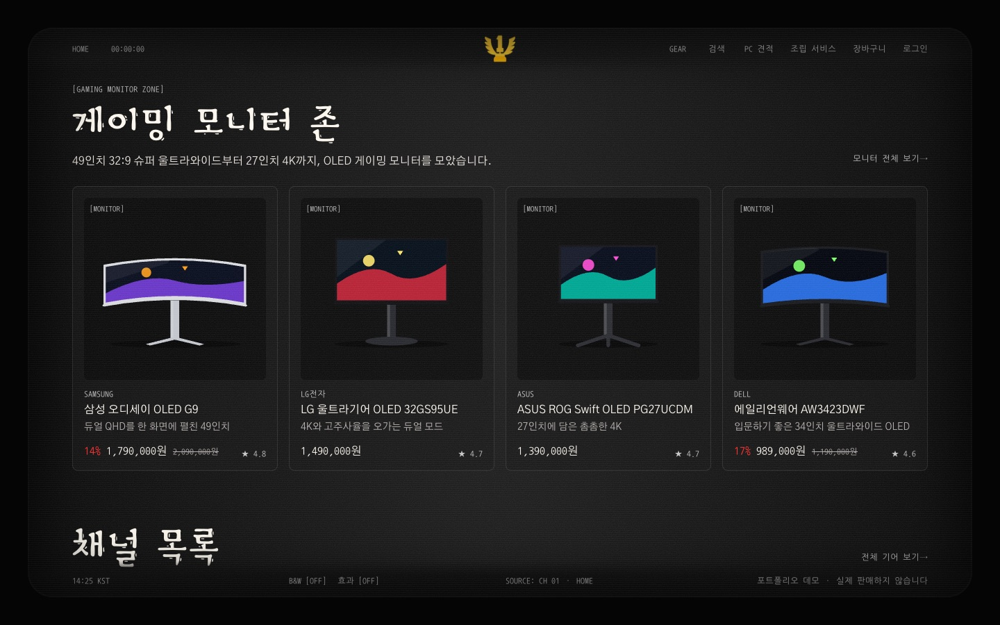 |

| PC 견적 | 예산별 빠른 견적 |
|---|---|
| 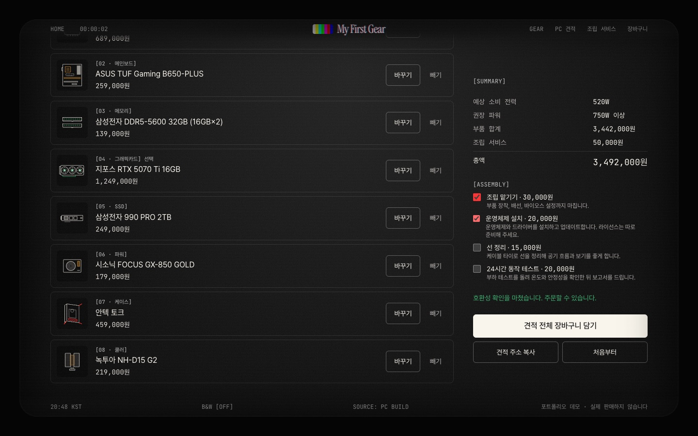 | 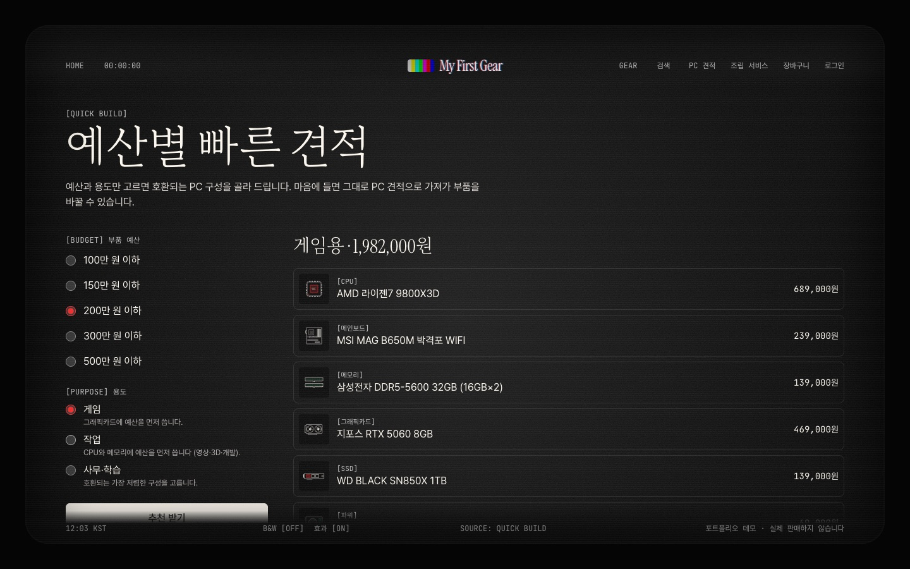 |

| 상품 상세 | 상품 비교 |
|---|---|
| 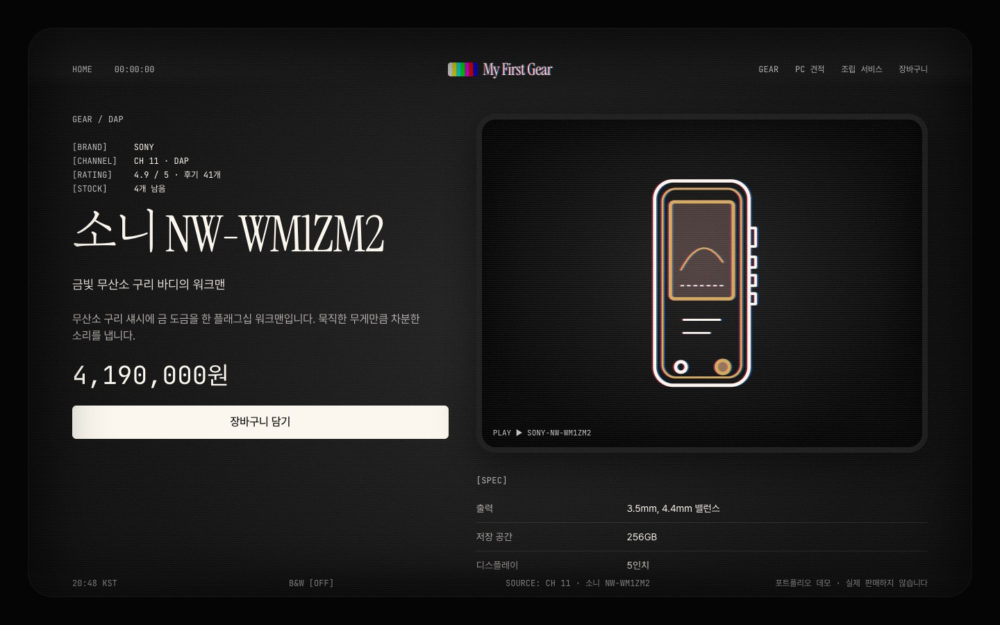 | 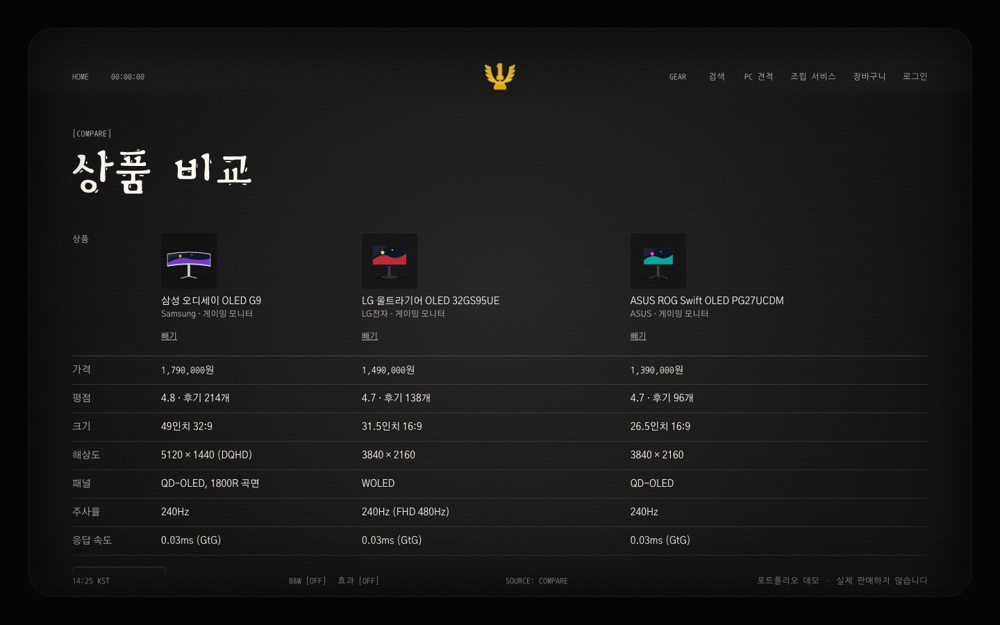 |

| 마이페이지 | 상품 후기·Q&A |
|---|---|
| 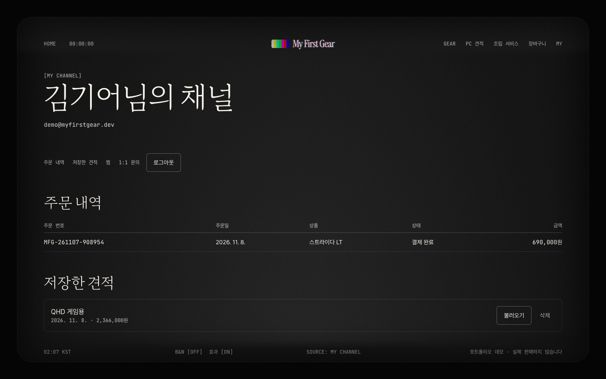 | 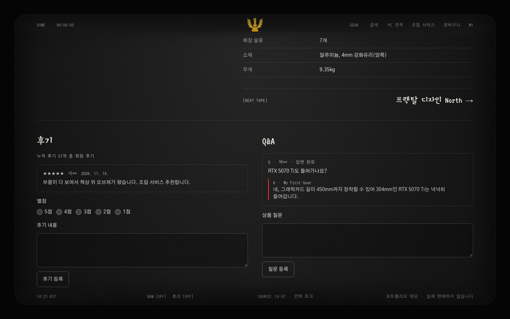 |

| 어드민 대시보드 (Bulma) | 어드민 판매 정보 |
|---|---|
| 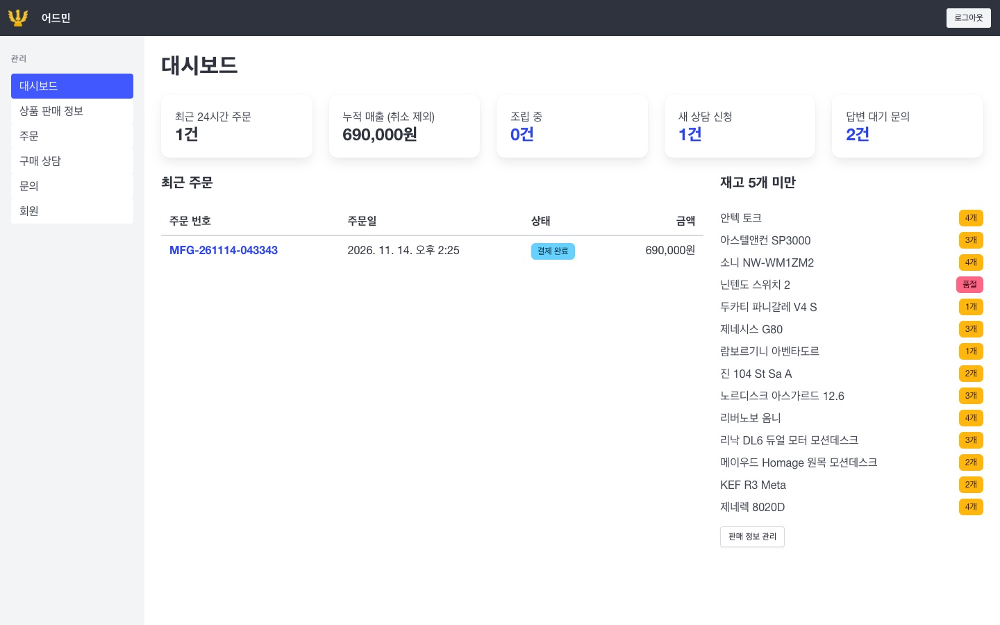 | 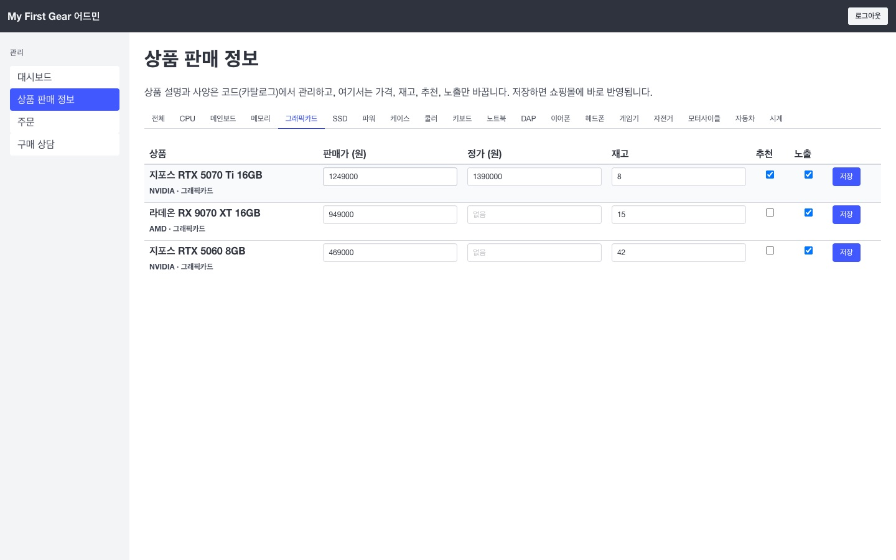 |

| 홈 조립 장면 (스크롤 고정) | 모바일 조립 장면 |
|---|---|
| 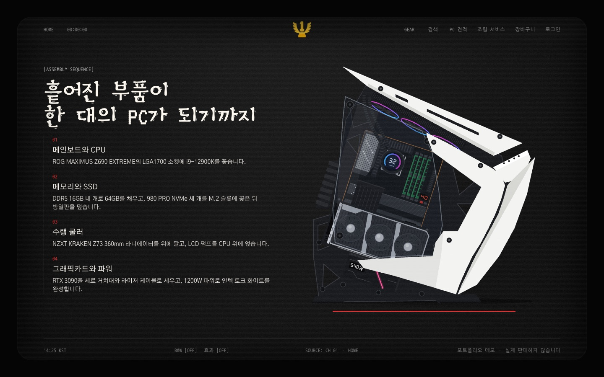 | 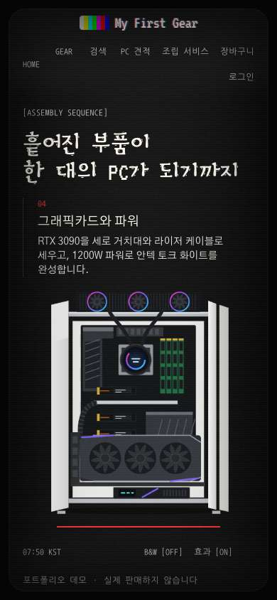 |

| 모바일 홈 | 어드민 문의 답변 |
|---|---|
| 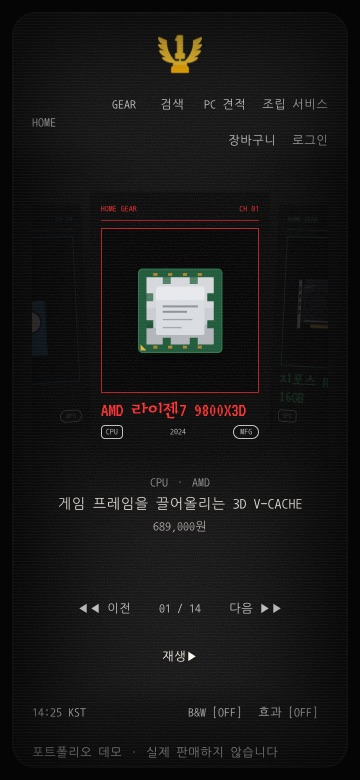 | 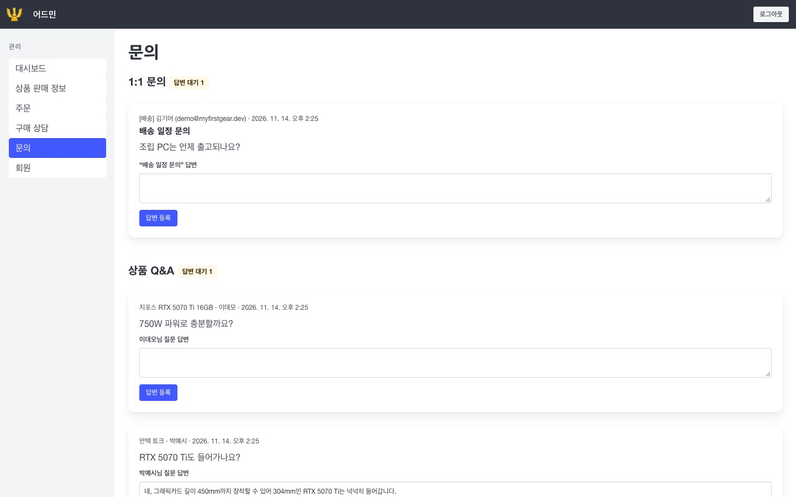 |

## 주요 기능

**쇼핑몰** (`apps/shop`, UnoCSS)

| 메뉴 | 내용 |
|---|---|
| 홈 | 브라운관 TV 프레임, ← → 키로 넘기는 VHS 테이프 캐러셀, 스크롤하면 부품이 케이스 안으로 모이는 조립 장면(화면 고정, CSS 스크롤 타임라인), 게이밍 모니터 존, 27개 카테고리 채널 목록 |
| 기어·검색 | 카테고리 목록, 필터·정렬(주소에 유지), 검색(카테고리 별칭 포함), 상품 비교(최대 4개), 최근 본 상품, 상품별 공유 이미지·구조화 데이터 |
| PC 견적·조립 | 부품 8칸 선택, 소켓·메모리·보드 크기·그래픽카드 길이·두께·전원 커넥터·쿨러 높이·파워 용량 검사, 예산·용도별 빠른 견적, 견적 주소·이미지 공유, 조립 옵션 |
| 데스크 셋업 | 책상·의자·모니터·모니터암·조명 등 9칸 선택, 모니터암 크기·무게와 책상 폭 검사, 주소 공유, 한 번에 담기 |
| 주문·상담 | 장바구니(담긴 부품 호환성 재검사), 모의 결제(서버에서 금액·재고 재계산), 주문 취소, 배송 단계, 비회원 조회, 고가 상품 상담 |
| 회원 | 가입·로그인(데모 `demo@myfirstgear.dev` / `demo1234`, 시도 제한), 후기·Q&A·찜·재입고 알림, 기기 간 장바구니·견적 동기화, 마이페이지 |

**어드민** (`apps/admin`, Bulma)

| 메뉴 | 내용 |
|---|---|
| 대시보드 | 최근 주문, 매출, 조립 중, 새 상담 건수, 재고 부족 상품 |
| 상품 판매 정보 | 가격·정가·재고·추천·노출 수정 → 쇼핑몰 캐시 즉시 갱신, 재입고 알림 신청 수 |
| 주문·상담·문의 | 주문 상태 변경과 이력, 상담 처리, 1:1 문의와 상품 Q&A 답변(쇼핑몰에 바로 반영), 회원 목록 |

쇼핑몰에서 들어온 주문·상담·문의는 어드민에, 어드민에서 바꾼 가격·재고와 답변은 쇼핑몰에 바로 반영됩니다. 데모 데이터는 매일 새벽 처음 상태로 돌아갑니다. KWCAG 2.2 33개 항목은 [접근성 점검표](docs/accessibility.md)에 정리했습니다.

## 기술 스택


| 구분 | 사용 기술 |
|---|---|
| 프레임워크 | Next.js 16 (App Router, Cache Components), React 19, TypeScript |
| 구조 | pnpm 워크스페이스 + Turborepo 모노레포, Feature-Sliced Design v2.1 (steiger 검사) |
| 스타일 | 쇼핑몰 UnoCSS (`presetWind4`), 어드민 Bulma 1 |
| 데이터 | PostgreSQL (Neon 싱가포르, 로컬·테스트는 PGlite), Drizzle ORM, 서버 액션, `next/og` 공유 이미지 |
| 품질 | ESLint, Steiger, Vitest + Testing Library(컴포넌트·접근성(axe)·호환성·로컬 Postgres 통합 테스트), Playwright E2E(데스크톱·모바일, axe, 조작 크기·중복 id·더블 클릭 검사), eslint-plugin-jsx-a11y, size-limit, Lighthouse CI |
| 모니터링 | Sentry(쇼핑몰, DSN이 있을 때만), web-vitals |
| 배포 | Vercel (쇼핑몰·어드민 두 프로젝트, 싱가포르 함수, Cron), GitHub Actions (CI, 배포 직후 운영 스모크 테스트) |

## 시작하기

Node.js 24(`.nvmrc`)와 pnpm 12가 필요합니다.

```bash
nvm use
corepack enable pnpm
pnpm install
pnpm --filter shop dev:db    # 로컬 Postgres(PGlite) + 쇼핑몰 http://localhost:3000
pnpm --filter admin dev:db   # 같은 DB로 어드민 http://localhost:3001 (비밀번호 demo-admin)
```

| 명령 | 설명 |
|---|---|
| `pnpm build` | 두 앱 프로덕션 빌드 |
| `pnpm lint` / `typecheck` | ESLint + FSD 검사 / 타입 검사 |
| `pnpm format` / `format:check` | Prettier로 서식 맞추기 / 서식 검사(CI) |
| `pnpm test` | 컴포넌트·접근성·호환성·DB 통합 테스트 |
| `pnpm test:e2e` | 프로덕션 빌드를 로컬 DB로 띄워 쇼핑몰·어드민 E2E |
| `pnpm --filter shop size` / `lhci` | 쇼핑몰 번들 크기 / Lighthouse 기준 검사 (먼저 `build` 필요) |
| `pnpm --filter shop test:smoke` | 운영 주소 스모크 테스트 (읽기 전용) |

## 프로젝트 구조

```
apps/
├─ shop/            쇼핑몰 (UnoCSS)
│  ├─ app/          Next 라우트 (src/_pages를 다시 내보내기만)
│  ├─ src/          FSD: _app, _pages, widgets, features, entities, shared (컴포넌트 옆에 *.test.tsx)
│  └─ vercel.json   빌드(마이그레이션 적용), 데모 초기화 크론
└─ admin/           어드민 (Bulma), proxy.ts 로그인 보호
packages/
├─ catalog/         상품·카테고리·호환성 검사·데스크 셋업 조합·검색·예산 추천 (순수 TS)
├─ gear-art/        실제 제품을 보고 그린 상품 SVG 91종
├─ hooks/           쇼핑몰·어드민이 함께 쓰는 React 훅(중복 제출 잠금)
└─ db/              Drizzle 스키마·쿼리·마이그레이션, 로컬 DB(PGlite) 실행 스크립트
```

## 문서

| 문서 | 내용 |
|---|---|
| [개발 가이드](docs/development.md) | 구조, 데이터 흐름, 디자인 기준, 접근성, 테스트 |
| [접근성 점검표](docs/accessibility.md) | KWCAG 2.2 33개 항목 대조 결과, Cache Components 주의점 |
| [배포](docs/deploy.md) | Vercel 두 프로젝트와 Neon 설정, 환경 변수, 마이그레이션, CI |
| [시퀀스 다이어그램](docs/sequence-diagrams.md) | PC 견적과 호환성 검사, 모의 결제 주문, 어드민 판매 정보 변경과 쇼핑몰 반영 |
| [버전 기록](CHANGELOG.md) | 버전별 변경 내용 |

## 출처

| 자료 | 저작자 | 사용 허락 | 원본 |
|---|---|---|---|
| VT323 (영문 큰 제목) | Peter Hull | SIL OFL 1.1 | [Google Fonts](https://fonts.google.com/specimen/VT323) |
| Black And White Picture (한글 큰 제목) | AsiaSoft Inc. | SIL OFL 1.1 | [Google Fonts](https://fonts.google.com/specimen/Black+And+White+Picture) |
| Gothic A1 (본문) | HanYang I&C Co | SIL OFL 1.1 | [Google Fonts](https://fonts.google.com/specimen/Gothic+A1) |
| Nanum Gothic Coding (라벨·금액) | Sandoll Communication (네이버 나눔글꼴) | SIL OFL 1.1 | [Google Fonts](https://fonts.google.com/specimen/Nanum+Gothic+Coding) |
| Pretendard Bold (공유 이미지) | 길형진 (orioncactus) | SIL OFL 1.1 | [GitHub](https://github.com/orioncactus/pretendard) |

상품 그림 SVG는 모두 실제 제품을 보고 직접 그렸고, 로고와 상표 문양은 넣지 않았습니다. 브라운관·VHS 화면 콘셉트는 [arc marumo](https://www.arcmarumo.com/)를 참고했으며 그 사이트의 자료는 가져오지 않았습니다.
