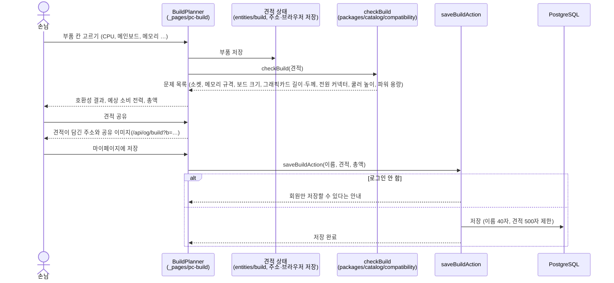
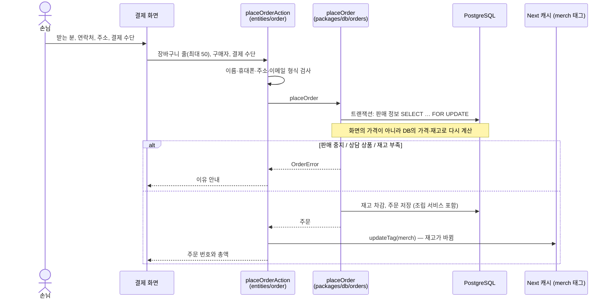
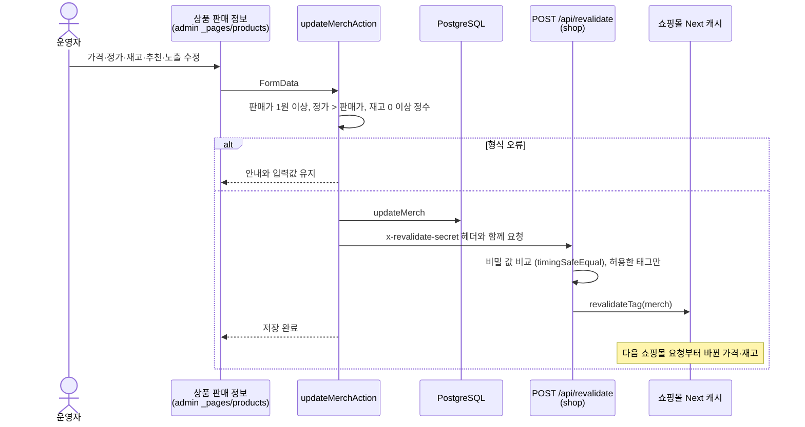

# 시퀀스 다이어그램

My First Gear의 주요 흐름입니다. 쇼핑몰(`apps/shop`)과 어드민(`apps/admin`)이 같은 PostgreSQL(`packages/db`)을 쓰고, 상품 정보와 호환성 규칙은 `packages/catalog`의 순수 TypeScript입니다.

## 1. PC 견적과 호환성 검사

## 2. 모의 결제 주문

## 3. 어드민 판매 정보 변경과 쇼핑몰 반영

